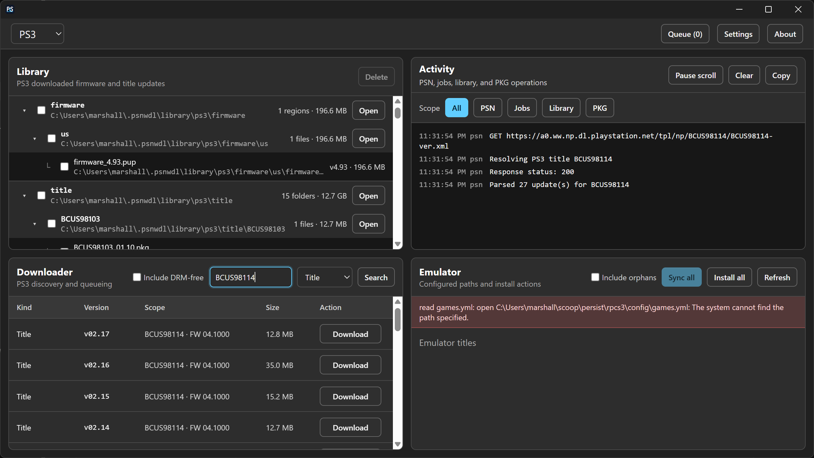
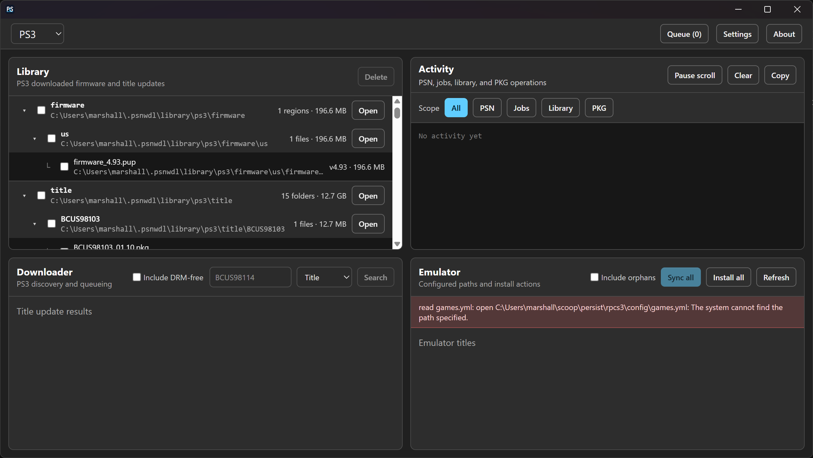
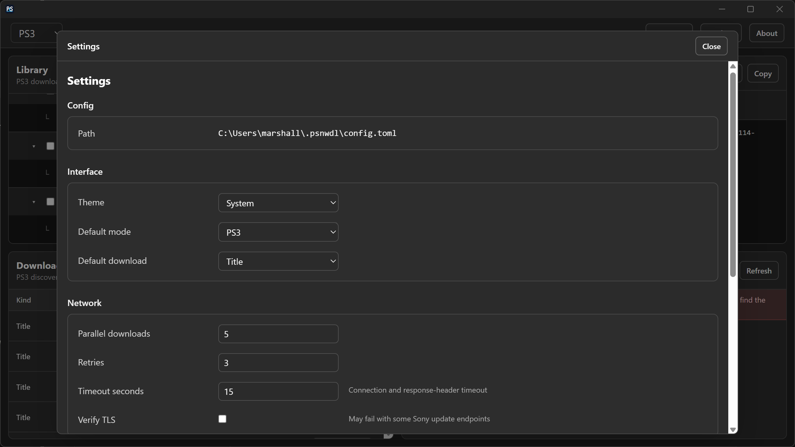

# PSNWDL

A cross-platform desktop app for browsing and caching **official** game-update
and firmware packages from the PlayStation Network update endpoints — for PS3,
PS4, PSVita, and PS5. Downloads are cached to disk for offline re-installation
into emulators (RPCS3 in particular) or firmware archiving.

PSNWDL does **not** patch, decrypt, or bypass any DRM. It only fetches the same
public, signed update packages that the consoles themselves request, and caches
them verbatim. PS3 PKG *extraction* (decryption of the NPDRM wrapper to files)
is performed locally by the app so updates can be dropped straight into an
RPCS3 `dev_hdd0/game` tree — but the PKGs themselves are unmodified.

> **Legal note:** Use only with titles and firmware you legitimately own.
> Sony's update endpoints are public; redistribution of downloaded packages is
> not. This tool is for personal archival / emulator setup.

## Screenshots

Search official PlayStation title updates and inspect available versions, sizes and download actions.



Browse locally cached firmware and title updates alongside the activity and emulator panes.



Configure interface defaults, parallel downloads, retries and network settings.



[Project website and screenshot gallery](https://meop.github.io/PSNWDL/).

## Installation

The current application version is recorded in [`VERSION`](VERSION).
Downloadable packages are produced for Windows, Linux, and macOS on both x64
and ARM64 from the
[GitHub Releases page](https://github.com/meop/PSNWDL/releases).

On Windows, install with [Scoop](https://scoop.sh) using the publisher's bucket:

```powershell
scoop bucket add meop https://github.com/meop/scoop-bucket
scoop install meop/psnwdl
```

The Scoop package supports x64 and ARM64 and requires Microsoft's WebView2 Runtime.

To update it:

```powershell
scoop update
scoop update psnwdl
```

The [Chocolatey package](https://community.chocolatey.org/packages/psnwdl) is
approved. Install or update it with:

```powershell
choco install psnwdl
choco upgrade psnwdl
```

Chocolatey installs the portable release for x64 or ARM64 and declares WebView2
as a dependency. Scoop and Chocolatey updates are published automatically after
stable releases created by this project's GitHub Actions pipeline. Chocolatey
versions must pass its review process before becoming available on the normal feed.

---

## Features

- **Title search** — look up a Title ID (e.g. `BCUS98114`) on PS3/PS4/Vita and
  see every published update version with size, hash, and download URL. PS3 can
  optionally include DRM-free package rows when Sony advertises them.
- **Latest firmware browser** — per-console firmware currently advertised by
  Sony's regional update lists, deduplicated by version.
- **Shared download queue** — one application-wide concurrency limit covers
  Download and Emulator actions. The header Queue flyout shows active jobs and
  cancellation; packages are verified with final size/SHA-1 checks and
  automatic retries.
- **Library manager** — shows downloaded title updates and region-grouped
  firmware files, with checkbox deletion by branch, folder, or individual file.
- **RPCS3 library synchronization (PS3 only)** — compares every server package
  for each RPCS3 title with the download library, reports none/some/all
  downloaded, removes unexpected packages, and downloads missing ones.
- **RPCS3 Library install (PS3)** — detects Library PKGs newer
  than RPCS3's installed versions and installs them in version order.
- **Activity** — a log of every fetch, reconcile, download, verify, and extract,
  filterable by scope (`psn` / `jobs` / `library` / `pkg`).
- **Light / dark / system theme** — applies live; persists in config.

---

## Inspiration

PSNWDL is inspired by AphelionWasTaken's
[PySN](https://github.com/AphelionWasTaken/PySN) and
[PyKG](https://github.com/AphelionWasTaken/PyKG), but it is not a 1:1 clone.
It combines PySN-style title/firmware discovery with PyKG-style PS3 package
inspection/extraction, then adds its own persistent library, workbench UI,
activity log, and RPCS3 reconcile/download/install flow.

| Capability | PySN | PyKG | PSNWDL |
|------------|------|------|--------|
| PS3/PS4/Vita title update lookup | Yes | No | Yes |
| PS5 title update lookup | Not supported | No | Not supported |
| PS3 DRM-free update rows | Yes | No | Yes, optional |
| Latest firmware by region | Yes | No | Yes |
| PS4 manifest-piece downloads | Yes | No | Yes |
| Download queue + verification | Yes | No | Yes, with size checks and automatic retries |
| Configurable concurrent downloads | Yes | No | Yes |
| Fixed cache/library view | No | No | Yes |
| RPCS3 installed-title reconcile | Partial | No | Yes |
| Queue missing RPCS3 updates | Partial | No | Yes |
| Install Library PS3 PKGs | No | Yes | Yes |
| PARAM.SFO metadata parsing | No | Yes | Yes |
| Retail/debug PS3 NPDRM extraction | No | Yes | Yes |
| Folder naming format options | Yes | No | No; fixed cache layout by design |

---

## Requirements

| Tool | Version | Why |
|------|---------|-----|
| [Go](https://go.dev/dl/) | ≥ 1.25 | backend and the pinned Wails 3 toolchain |
| [Node.js](https://nodejs.org/) | ≥ 20 | frontend toolchain |
| [pnpm](https://pnpm.io/) | ≥ 9 | frontend package manager |
| [Wails CLI](https://v3.wails.io) | v3 | build / dev harness |

Install the Wails CLI once:

```sh
go install github.com/wailsapp/wails/v3/cmd/wails3@v3.0.0-alpha2.121
```

### Runtime prerequisites

All release formats use the system webview; none bundles a private browser
engine. An archive or AppImage avoids an application installer, but still needs
these runtime libraries:

| Platform | Runtime requirement |
|---|---|
| Windows | Microsoft Edge WebView2 Runtime. The NSIS installer downloads it if missing; Chocolatey declares it as a dependency. ZIP/Scoop users must have it installed. |
| macOS | The operating system's built-in WebKit; no separate webview installation. |
| Linux | GTK4 and WebKitGTK 6.0, plus a compatible glibc system. The general Linux binary is built on Ubuntu 24.04; Alpine uses a separate musl-native APK. |

For the Linux archive or AppImage on Ubuntu 24.04 / Debian 13:

```sh
sudo apt install libgtk-4-1 libwebkitgtk-6.0-4
chmod +x psnwdl-<version>-linux-x86_64.AppImage
./psnwdl-<version>-linux-x86_64.AppImage
```

AppImage does not install missing dependencies or sandbox the app. On systems
without usable FUSE support, run it with `--appimage-extract-and-run`. Choose
`aarch64` instead of `x86_64` on ARM64 Linux systems. GTK3/WebKitGTK 4.x alone is insufficient.
The native Linux packages declare dependencies for their package managers.

Archives and AppImages use the normal `~/.psnwdl` configuration/library locations;
they do not keep user data beside the executable by default.

- **For Emulator install/extraction**, you need [RPCS3](https://rpcs3.net/) and its
  `games.yml` plus `dev_hdd0/game` paths (set in Settings).
- **No additional emulator prerequisites for PS4/Vita/PS5** — those only fetch and cache the
  signed packages; they are not extracted.

---

## Build & run

### Live development (hot reload)

```sh
wails3 dev
```

Runs the Vite dev server with hot reload and launches the native application.
The development server listens on `http://127.0.0.1:9245`; the Wails window
connects to it automatically.

### Production build

```sh
wails3 build
```

Outputs the platform-native binary into `bin/`. Run `wails3 task package` to
create the host platform's installer/package. The generated Wails 3 Taskfiles
also provide Docker-backed cross-compilation tasks where the target requires
platform tooling.

Linux builds use GTK 4 and WebKitGTK 6.0. On Ubuntu 24.04 or newer, install
their development packages before building:

```sh
sudo apt install build-essential pkg-config libgtk-4-dev libwebkitgtk-6.0-dev
```

Release packages declare the corresponding runtime dependencies, so the
system package manager installs them automatically:

```sh
# Debian 13 / Ubuntu 24.04+
sudo apt install ./psnwdl_<version>-1_amd64.deb

# Fedora
sudo dnf install ./psnwdl-<version>-1.x86_64.rpm

# Arch Linux (direct prebuilt package)
sudo pacman -U ./psnwdl-<version>-1-x86_64.pkg.tar.zst

# Alpine Linux 3.22+
sudo apk add --allow-untrusted ./psnwdl_<version>-r1_x86_64.apk
```

The Alpine APK contains a separate musl-native build; it is not the Ubuntu
binary repackaged under a different extension. Release APKs are currently
unsigned, hence Alpine's `--allow-untrusted` flag for a downloaded local file.

The direct Arch package can be downloaded and installed with `pacman -U`. The
separate AUR-ready release tarball contains `PKGBUILD` and `.SRCINFO` for the
prebuilt `psnwdl-bin` package. Once that recipe is published to the AUR, `yay`
or another AUR helper fetches the matching GitHub release binary and builds the
Pacman package locally. Both approaches depend on Arch's `gtk4` and
`webkitgtk-6.0` packages.

### Versioning and release builds

`VERSION` is the only file edited to change the application version. The
frontend reads it directly. After changing it, synchronize Wails' generated
platform metadata:

```powershell
./scripts/Sync-Version.ps1
```

Prerelease suffixes remain visible in the app, Linux packages, artifact names,
tags, and GitHub releases. Numeric-only Windows and macOS metadata receives the
three-part core version. For example, `1.2.3-rc.1` becomes `1.2.3` only in those
native numeric fields.

The GitHub Actions pipeline validates every branch and pull request. A push to
`master` whose `VERSION` has no existing `v<VERSION>` tag builds these artifacts:

- Windows x64 and ARM64: per-user NSIS installer and ZIP archive
- Linux x64 and ARM64: DEB, RPM, Arch package, Alpine APK, tarball, and AppImage
- macOS Intel and Apple Silicon: DMG and `.app` ZIP archive
- AUR-ready `psnwdl-bin` source package (`PKGBUILD` + `.SRCINFO`)
- `SHA256SUMS` covering every release artifact
- `SHA256SUMS.sig`, a detached GPG signature made by the release key

Archives, installers, DMGs and AppImages retain the platform's architecture
labels: Windows `x64`/`arm64`, Linux `x86_64`/`aarch64`, and macOS
`x86_64`/`arm64`. New releases omit the ambiguous `portable` suffix; existing
releases retain their original filenames and URLs. Native Linux packages keep
the conventional filenames generated by nFPM:

| Artifact | Filename convention |
|---|---|
| Windows installer | `psnwdl-<version>-windows-{x64,arm64}-setup.exe` |
| Windows archive | `psnwdl-<version>-windows-{x64,arm64}.zip` |
| Linux archive | `psnwdl-<version>-linux-{x86_64,aarch64}.tar.gz` |
| Linux AppImage | `psnwdl-<version>-linux-{x86_64,aarch64}.AppImage` |
| Debian | `psnwdl_<deb-version>_{amd64,arm64}.deb` |
| RPM | `psnwdl-<rpm-version>-1.{x86_64,aarch64}.rpm` |
| Arch Linux | `psnwdl-<arch-pkgver>-1-{x86_64,aarch64}.pkg.tar.zst` |
| Alpine | `psnwdl_<apk-pkgver>-r1_{x86_64,aarch64}.apk` |
| macOS DMG | `psnwdl-<version>-macos-{x86_64,arm64}.dmg` |
| macOS archive | `psnwdl-<version>-macos-{x86_64,arm64}.zip` |
| AUR recipe | `psnwdl-<version>-linux-aur-source.tar.gz` |

The AppImage contains the app, launcher, icon and license, and uses installed
GTK4/WebKitGTK libraries and helper processes. It deliberately contains no
bundled GTK/WebKit shared libraries. Build it after a native Linux build with
`bash scripts/New-AppImage.sh` (requires curl and desktop-file-utils). The script
verifies pinned appimagetool 1.9.1 and type2-runtime 20251108 SHA256 hashes.

Manually dispatching the Pipeline workflow builds and checks all six targets
without publishing a release or submitting distribution packages. Linux jobs
also extract the AppImage, verify its contents and dynamic dependencies, and
launch it under Xvfb using the system libraries.

Package managers adapt semantic prereleases to their own ordering syntax. For
`0.1.1-rc.3`, the complete version/release portion is `0.1.1~rc.3-1` inside
DEB/RPM metadata, `0.1.1rc.3-1` for Arch, and `0.1.1_rc.3-r1` for Alpine.
GitHub rewrites the `~` in uploaded asset names to `.`, so the release workflow
performs that normalization before generating `SHA256SUMS`; the DEB/RPM package
metadata retains the native `~` version ordering.

Every distributed binary package contains `LICENSE`; GitHub's generated
source archives contain the tracked root copy as well. The release does not
attach a redundant standalone `LICENSE` asset.

Verify the checksum manifest with the public release key, then verify the
downloaded artifacts:

```sh
gpg --verify SHA256SUMS.sig SHA256SUMS
sha256sum --check SHA256SUMS
```

It then creates a signed tag, generates the changelog, and publishes the
release. A hyphenated version such as `1.2.3-rc1` becomes a GitHub prerelease.
Configure repository secrets `GPG_PRIVATE_KEY` and `GPG_PASSPHRASE` before the
first release run. These secrets sign the Git tag; platform code-signing and
Apple notarization are separate and are not yet configured, so Windows may show
SmartScreen and macOS may show Gatekeeper warnings for these RC packages.

### Application icons

The icon generator defines custom geometric P/S letterforms over a flat
download arrow and tray. On Windows, edit and run the generator to recreate the
complete set:

```powershell
./scripts/Generate-Icons.ps1
```

This replaces the reviewable `build/appicon.svg` plus `build/appicon.png`,
`build/windows/icon.ico`, and `build/darwin/icons.icns` from the same design
definition.

---

## Project layout

```
PSNWDL/
├── LICENSE                # MIT license included with source and binary packages
├── VERSION                # single source of application/release version
├── .github/workflows/     # validation, six-platform build matrix, release
├── docs/upstream.md       # potential and resolved upstream reports
├── app.go                 # Wails-bound methods (the app's public API surface)
├── main.go                # Wails app bootstrap
├── Taskfile.yaml          # Wails 3 build/dev/package entry points
├── build/
│   ├── appicon.svg        # generated reviewable vector application icon
│   ├── config.yml         # generated product metadata + dev configuration
│   └── {windows,darwin,linux}/ # platform Taskfiles and packaging assets
├── scripts/               # version sync and canonical icon generator
├── internal/
│   ├── activity/          # in-memory log ring buffer + event emitter
│   ├── config/            # config.toml load/save, defaults, path helpers
│   ├── jobs/              # download queue: enqueue/pause/resume/retry/verify
│   ├── library/           # games.yml reconciliation, PARAM.SFO version compare
│   ├── pkg/               # PS3 NPDRM PKG header parse, decrypt, extract
│   ├── psn/               # PS3/PS4/PS5/Vita update-XML + firmware fetchers
│   └── rpcs3/             # games.yml parsing, installed-title discovery
└── frontend/
    ├── src/
    │   ├── app/           # stores, theme, types, startup sizing
    │   ├── components/    # shared Loading component
    │   ├── pages/         # Workbench, Activity log, Settings overlay
    │   ├── App.svelte     # shell: mode selector, settings/about overlays
    │   ├── main.ts        # mount + pre-paint config load (no theme flash)
    │   └── style.css      # semantic color tokens (@theme inline) for theming
    └── bindings/          # generated Wails 3 TS bindings (do not hand-edit)
```

---

## Configuration

Config lives at `~/.psnwdl/config.toml` (created with defaults on first run):

```toml
[rpcs3]
games_yml = ""     # absolute path to RPCS3/games.yml (auto-detectable)
hdd0_game = ""     # absolute path to RPCS3/dev_hdd0/game (for PS3 install)

[storage]
library_dir = "/home/you/.psnwdl/library"  # base folder for downloaded files

[network]
parallel_downloads = 5
retries = 3
timeout_seconds = 15 # metadata requests and download connection/header timeout
verify_tls = false

[ui]
theme = "system"            # system | dark | light
default_mode = "ps3"        # ps3 | ps4 | psvita | ps5
default_download = "firmware" # firmware | title
```

The first-run file and every file saved through Settings contain the complete
configuration, including default-valued fields. A manually shortened file is
accepted: omitted fields receive defaults in memory and are written out on the
next Settings save. RPCS3 paths selected in Settings must point to an existing
`games.yml` file and an existing `dev_hdd0/game` directory.

`home_dir` is exposed to the UI (resolved at runtime) but never persisted.
TLS verification defaults off because several Sony endpoints use certificates
that fail normal desktop validation.

Set `PSNWDL_CONFIG` to override the config file path for testing or portable
setups.

### Cache layout

Downloaded files are separated by platform and content type. Firmware is grouped
by region under `firmware`; title updates are grouped by title ID under `title`:

```
~/.psnwdl/library/
├── ps3/
│   ├── firmware/us/firmware_4.93.pup
│   └── title/BCUS98114/BCUS98114_01.05.pkg
├── ps4/
│   ├── firmware/<region>/<firmware>.pup
│   └── title/CUSA00000/<update>.pkg
├── ps5/firmware/us/firmware_26.04-13.40.00.pup
└── …
```

Downloads are stored as the raw signed packages Sony ships. PS3 extraction into
RPCS3 is an explicit Emulator action.

---

## How the API surface is wired

The frontend calls Go exclusively through Wails-generated bindings in
`frontend/bindings/PSNWDL/`. `main.go` registers `App` as a Wails service, and
every exported `func (a *App)` in `app.go` becomes a typed TS function. If you
change a Go signature or add/remove a method:

```sh
wails3 generate bindings -clean=true -ts
```

This must exit `0`. If it prints `Not found: time.Time`, a struct field is
using `time.Time` (or another unmapped type) — use an RFC3339 `string` instead
(see `activity.Entry.Ts`).

---

## Verifying a clean build

```sh
go build ./...
go vet ./...
go test -coverprofile coverage.out ./...
wails3 generate bindings -clean=true -ts
cd frontend && pnpm install && pnpm run build && pnpm run check
cd .. && wails3 build
```

`pnpm run check` should report **0 errors and 0 warnings**. If it doesn't, fix
before considering the work done.

---

## License

PSNWDL is released under the [MIT License](LICENSE). Downloaded PlayStation
packages are not covered by that license: they remain Sony's signed content and
must not be redistributed.
